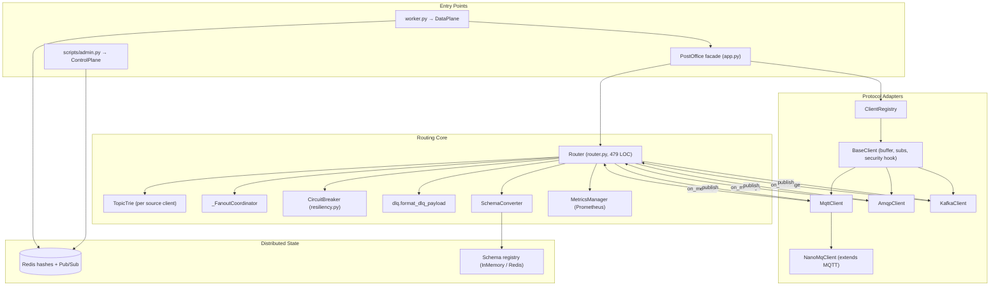
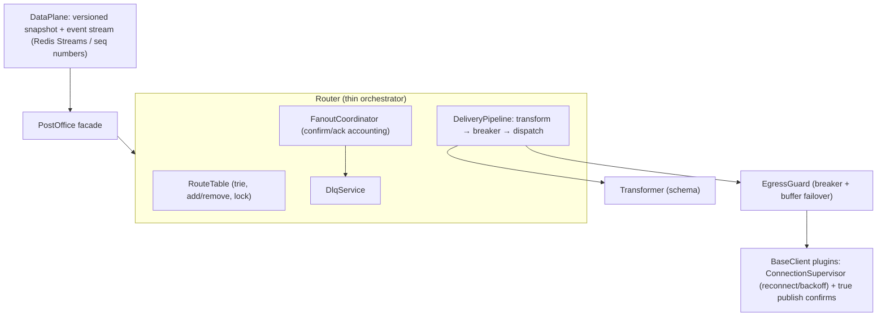
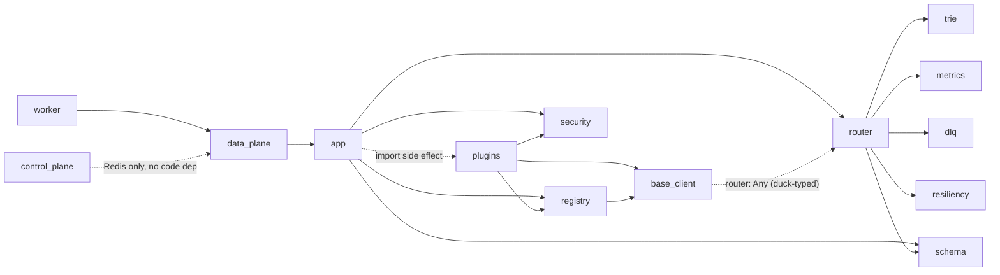

# Architecture & Code Review Improvement Plan: PostOffice

> **Repository:** `/home/bill/src/meso/PostOffice`
> **Date:** `2026-10-25` (HEAD `5bfe178`, v2.1.0)
> **Review Scope:** Full repository (`src/postoffice/**`, `scripts/`, config; tests read for coverage shape only)
> **Reviewer:** Claude (Sonnet 5.5) using `code-architecture-review`, graphify AST graph (1202 nodes / 1629 edges) plus manual read of every source module
> **Architecture Health Score:** `B-` (Score: `74/100`)
> **Baseline:** `PYTHONPATH=src .venv/bin/python -m unittest discover tests/` → 106 tests, OK

**Method note.** Findings below come from reading the code. They were not reproduced against live brokers, because the unit suite mocks all network clients. Where a finding depends on library behaviour (librdkafka defaults, paho semantics), it is flagged *"verify against live broker"*.

---

## 1. Code Architecture

### 1.1 Executive Architectural Summary

PostOffice is a layered, plugin-based message bridge:

- **Facade** (`PostOffice`) → **routing core** (`Router` + `TopicTrie` + `SchemaConverter` + `CircuitBreaker` + DLQ) → **protocol adapters** (`BaseClient` subclasses registered via `ClientRegistry`).
- A second axis splits **Control Plane** (writes Redis, publishes Pub/Sub events) from **Data Plane** workers (hydrate from Redis, apply live events to an embedded `PostOffice`).

The shape is sound. Dependencies point inward (plugins → `BaseClient`/`registry`/`security`; `Router` knows only duck-typed clients). There are no import cycles. The weak spots are not structural layering. They sit in three places:

1. **`Router.route()` is a 250-line god function** that interleaves matching, schema transform, circuit breaking, buffering, DLQ, fan-out coordination and metrics. Most delivery-guarantee defects live there.
2. **The "zero message loss" core value is not upheld by the adapters.** `on_confirm` fires before the broker has confirmed (MQTT, AMQP). Kafka confirms can stall. Reconnect handling is missing or partial in all three.
3. **The Control/Data Plane protocol is not eventually consistent.** It has a subscribe-after-sync race, non-idempotent replays, and a broken `clear_state` recovery path.

### 1.2 Current System Topology



Note: `DataPlane` does not wire `RedisSchemaRegistry`. `PostOffice()` defaults to `InMemorySchemaRegistry`, so the distributed registry is currently reachable only by library users who construct it themselves (see P1.6).

### 1.3 Target Architecture Blueprint



Key target-state changes:

- Split `route()` into small, individually testable stages.
- Give every adapter a shared **reconnect supervisor** and **real delivery confirms**.
- Replace Pub/Sub-only config propagation with **snapshot + sequenced events** (Redis Streams, or Pub/Sub plus a version counter).

### 1.4 Architectural Debt & Trade-off Analysis

- **Intentional trade-offs (reasonable):** duck-typed `Router.clients` (keeps tests hermetic); Prometheus registry per `Router` (isolates tests); `NanoMqClient` as a thin `MqttClient` subclass; in-memory schema registry default.
- **Accidental complexity:**
  - `route()` duplicates the "coordinator vs. direct DLQ" branch five times.
  - `excluded_keys` and the `wire_format*` defaulting logic live inline in the hot path.
  - `Router.routes` is a second copy of the trie contents ("kept for inspection").
  - `_topic_match` is dead in production (only `tests/test_wildcards.py` calls it) and duplicates trie semantics, so the two can drift.
- **Scalability bottlenecks:**
  - `route()` runs synchronously on each broker's callback thread: paho's network thread, pika's `process_data_events` thread, and the Kafka poll thread. Slow egress or DLQ publishes stall ingest.
  - `AmqpClient.publish` issues `queue_declare` per message.
  - `logger.info` on every message logs the full payload and kwargs (see P1.5).

---

## 2. Code Module & Component Review (Intra-Module)

### 2.1 Component Scorecard

| Component | Role | Cohesion | Complexity | Test Coverage | Health |
| :--- | :--- | :---: | :---: | :---: | :---: |
| `router.py` | Routing, DLQ, transforms, breaker, fan-out | **Low** | **High** | High (many scenario tests) | **C** |
| `base_client.py` | Adapter ABC + publish buffer + sub registry | High | Low | High | **B+** |
| `plugins/mqtt_client.py` | MQTT adapter | Med | Med | Med (mocked) | **C+** |
| `plugins/amqp_client.py` | AMQP adapter | Med | Med | Med (mocked) | **C** |
| `plugins/kafka_client.py` | Kafka adapter | Med | Med | Med (mocked) | **C** |
| `plugins/nanomq_client.py` | MQTT variant | High | Low | Med | **A-** |
| `app.py` | Facade | High | Low | High | **B** |
| `data_plane.py` | Worker sync + live updates | Med | Med | High | **C+** |
| `control_plane.py` | Redis admin | High | Low | High | **B-** |
| `trie.py` | Topic matching | High | Low | High | **A-** |
| `resiliency.py` | Circuit breaker | High | Low | High | **A-** |
| `security.py` | TLS/auth dataclass | High | Low | High | **B+** |
| `schema/registry.py` | Schema registries | Med | Med | High | **B-** |
| `schema/converters.py` | JSON/Avro/Protobuf convert | High | Low | High | **B+** |
| `metrics.py` | Prometheus | High | Low | High | **A-** |
| `dlq.py` / `registry.py` / `worker.py` | Small helpers | High | Low | Med–High | **A** |

### 2.2 Component Deep Dive & Findings

#### `router.py`

- **SRP:** `route()` (lines 227–476) handles at least nine concerns. `_FanoutCoordinator` is a good extraction and should be the model for the rest.
- **Defects found:**
  - **R1: wrong DLQ target on fan-out.** `_handle_dlq_on_error` (l.274–288) always reads `matching_routes[0]` for `dlq_broker`/`dlq_topic`. The coordinator's error callback does not say which route failed, so a failure on route #2 is sent to route #1's DLQ (or the global one).
  - **R2: "success" metric is recorded at dispatch, not at confirm** (l.439–441). With async adapters this overstates delivery.
  - **R3: DLQ publish runs while holding the coordinator lock** (`on_error`, l.45–60). A slow or blocked DLQ broker blocks every other route's confirm callback for that message.
  - **R4: unroutable messages are silently acked** when no DLQ is configured (l.270–271). That is a defensible default, but it contradicts "zero message loss" and should be an explicit policy (`on_unroutable = ack|nack|dlq`).
  - **R5: `Router.routes` / trie can double-insert.** `add_route` is not idempotent, so replaying the same route (e.g. Redis state replay, see D3) delivers duplicates.
  - **R6: no `remove_route`, and no lock.** Routes added by the data-plane listener thread mutate structures that broker threads read concurrently. This is mostly safe under the GIL for appends, but it is unsynchronized and there is no way to delete a route.
- **Type safety:** route config is an untyped `Dict[str, Any]`, with internal keys (`target_client`, `dlq_*`, `input_*`, `wire_format*`) mixed with broker kwargs and separated afterwards by a hard-coded exclusion tuple. A typo in a route kwarg flows straight to `client.publish(**kwargs)`.
- **Error handling:** mostly good (logged, routed to DLQ). The `except TypeError: nack_fn()` fallback pattern appears three times and will mask a real `TypeError` raised inside `nack_fn`.

#### `plugins/mqtt_client.py`

- **M1: `on_confirm` is called immediately after `client.publish()` returns** (l.135–137). Paho only *queues* the message; `info.rc` is never checked and `wait_for_publish`/`on_publish` are not used. For QoS 1/2 the source ack is therefore sent before the broker has confirmed.
- **M2: no auto-reconnect if the first `connect()` fails.** `client.connect()` raises (only `ConnectionRefusedError` is caught; DNS failure and `socket.timeout` propagate), so `loop_start()` is never reached and paho's reconnect logic never runs. Use `connect_async()` + `loop_start()` + `reconnect_delay_set()`.
- **M3:** `_on_connect` ignores `reason_code` failures (e.g. auth refused) and still tries to subscribe/flush.

#### `plugins/amqp_client.py`

- **A1: `on_confirm` after `basic_publish` without publisher confirms** (l.173–182). `channel.confirm_delivery()` is never enabled, so a mandatory-less publish to a missing exchange is silently dropped and reported as success.
- **A2: no reconnect.** A failed first connect returns from the thread. A mid-run exception `break`s the loop (l.231–234). In both cases `self.channel`/`self.connection` still hold dead objects, so `publish()` never takes the buffering path (`if not self.channel`) and instead raises on `add_callback_threadsafe`.
- **A3: `auto_ack` defaults to `True`** (l.89), so consumed messages are acked to RabbitMQ before routing. This is a loss window that contradicts the project's core value. The default should be `False` for bridge use.
- **A4:** `nack_fn(requeue=True)` with no DLQ configured creates an unbounded redelivery loop for poison messages (e.g. schema failure).
- **A5:** `queue_declare` on every publish; hard-coded fallback credentials `user`/`password` (l.28–29); `virtual_host` hard-coded to `/`.
- **A6:** `connect()` blocks up to 2 s per AMQP broker, serially in `PostOffice.start()`.

#### `plugins/kafka_client.py`

- **K1: `producer.poll(0)` is only called inside `publish()`** (l.160). Delivery callbacks fire only when polled, so after the last publish of a burst the `on_confirm` (and therefore the source ack, and circuit-breaker `record_success`) can be delayed indefinitely. Add a producer-poll thread or poll in the consume loop.
- **K2: offsets can be committed out of order and `enable.auto.commit` is left at the librdkafka default (`true`)** *(verify against live broker)*. With auto-commit on, consumed offsets are committed regardless of routing success. With manual `commit(message=msg)` from asynchronous callbacks, a later offset commit implicitly covers earlier unacknowledged messages. Both break at-least-once. Set `enable.auto.commit=false` (or `enable.auto.offset.store=false`) and track per-partition contiguous completion.
- **K3:** `connect()` catches `KafkaError`, but `Producer(...)` / `Consumer(...)` raise `KafkaException` / `ValueError` for bad config, so a bad config escapes uncaught.
- **K4:** `publish()` calls `on_error(e)` **and re-raises** (l.161–165), so the router's own `except` path also handles it. This relies on `error_recorded`/`coordinator.failed` for dedup. It works today but is fragile.
- **K5:** `reload_security()` calls `disconnect()` but leaves `producer`/`consumer` set to the closed objects until `connect()` replaces them. Publishes during the window hit a closed handle rather than the buffer.

#### `base_client.py`

- Good: RLock-guarded buffer, explicit overflow policies, subscription replay record, and `reload_security` as a no-op hook.
- **B1: `flush_publish_buffer` can lose items.** It pops an item and then calls `publish`. If `publish` re-buffers or raises midway (client disconnects again mid-flush), the remaining items stay but the failing one may be dropped and its callbacks are never invoked.
- **B2: the buffer is unbounded in time.** There is no TTL, so stale messages can be flushed hours later. Consider a `max_age` option.
- Buffered messages are in memory only. Process restart loses them; this should be documented as a limitation.

#### `app.py` (Facade)

- **F1 (functional bug): `reset()` leaves the instance unusable.** `stop()` is followed by `is_running = False` and a new `Router`. `DataPlane` calls `po.reset()` on `clear_state` and then keeps applying `add_broker` events. Because `is_running` is `False`, `add_broker` never connects those brokers, and nobody calls `start()` again. The data plane silently goes dead after a `clear_state`. The new `Router` also gets a fresh `MetricsManager`, whose HTTP server is not restarted, and its circuit-breaker config is lost.
- **F2:** `subscribe()` and `start()` swallow exceptions into logs, so callers (and `DataPlane.sync_state`) cannot detect a failed subscription or connect.
- **F3:** `Router` replacement in `reset()` orphans any external references to `po.router`.

#### `data_plane.py` / `control_plane.py`

- **D1 (race): `sync_state()` runs before `pubsub.subscribe()`.** Updates published between the snapshot and the subscribe are lost permanently. Pub/Sub has no replay, so workers can diverge from Redis state.
- **D2:** `sync_state` retry is not idempotent. If `hgetall` succeeds but a later call fails, the retry re-runs `add_broker` for already-added brokers and raises `ValueError` ("already exists"). That is not a `redis.ConnectionError`, so it aborts the worker.
- **D3:** the same route or broker published twice, or replayed after reconnect, duplicates routes in the trie (see R5). The listener's reconnect loop does not resync state after an outage, so missed events are never recovered.
- **D4:** `_process_update_message` is an `if/elif` ladder keyed on strings. It does not match the Open/Closed principle and has no schema for event payloads.
- **D5: secrets exposure.**
  - `ControlPlane._publish_update` logs the full payload at INFO (`l.20`), including broker `security_config` (passwords, key passwords).
  - Credentials are stored in plaintext Redis hashes and broadcast over unauthenticated Pub/Sub.
  - `DataPlane`/`ControlPlane` take only `host`/`port`, with no Redis password or TLS.
- **D6:** `DataPlane.__init__` creates a `pubsub` that is immediately replaced in `_listen_for_updates`, and `_stop_event` is not used to unblock `pubsub.listen()` on shutdown (the thread is a daemon, so this only affects clean teardown).
- **D7:** `update_broker_security` for a broker missing in Redis publishes an event anyway. Workers raise `ValueError` for unknown brokers, but the control plane gets no feedback.

#### `schema/*`

- **S1:** `RedisSchemaRegistry.register_schema` is a non-atomic read-then-write (`hgetall` → `incr` → `hset`), so concurrent registers of the same name can produce inconsistent versions.
- **S2:** the local cache never invalidates. A version bump on worker A is invisible to worker B until restart.
- **S3:** the bytes-vs-str handling is repeated inline (`data.get("x") or data.get(b"x")`). Normalizing via `decode_responses` or a helper would remove the pattern.
- **S4:** `PROTO_FIELD_TYPES` silently falls back to `string` for unknown types (`l.79`), which hides schema typos. This is the kind of silent failure to turn into a `ValueError`.
- No schema-compatibility rules exist on re-register (BACKWARD/FORWARD), so version bumps are unchecked.

#### `trie.py`, `resiliency.py`, `security.py`, `metrics.py`, `dlq.py`

- Small, cohesive, well-tested. Minor notes:
  - `trie.py`: no `remove()`; MQTT `$`-topic rule (`#`/`+` must not match topics starting with `$`) not implemented.
  - `resiliency.py`: half-open allows exactly one probe, which is correct. If the probe's callback never fires (see K1), the breaker stays `HALF_OPEN` with `_probe_in_flight=True` forever and blocks all traffic. Add a probe timeout.
  - `security.py`: `SecurityConfig.password`/`client_key_password` appear in `repr()` and `asdict()`, so mark them `field(repr=False)`.
  - `metrics.py`: `from wsgiref.simple_server import WSGIServer` is imported only for a type annotation.

---

## 3. Code Inter-Module Review (Cross-Component)

### 3.1 Inter-Module Dependency Matrix



### 3.2 Coupling & Cohesion Assessment

- **Afferent coupling (most depended on):** `BaseClient` (4 plugins + registry), `Router` (facade, every client via `on_message`), `SecurityConfig` (3 plugins + facade).
- **Efferent coupling (heaviest):** `router.py` imports 5 first-party modules and implicitly depends on client methods `buffer_publish` / `flush_publish_buffer` through `hasattr`. `app.py` imports plugins purely for registration side effects.
- **Circular dependencies:** none at import level. There is a runtime cycle by design: `Router` → `client.publish` → callbacks → `Router`/`Coordinator`. It is correct but hard to reason about because callbacks fire on foreign threads.
- **Hidden contract:** `Router` ↔ `BaseClient` is a protocol that exists only in docstrings: `publish(topic, msg, on_confirm, on_error, **kw)`, `buffer_publish`, `flush_publish_buffer`, `nack_fn(requeue=...)`. It is checked with `hasattr` and `except TypeError`. A `typing.Protocol` would turn this into a checked contract.

### 3.3 Interface & Boundary Integrity

- **Contract strictness:** the weakest boundary is the route/target `**kwargs` bag. It carries routing metadata, schema options and broker-native options (`qos`, `exchange`, `delivery_mode`, `key`, `partition`) in one namespace. Semantic translation (`_translate_semantics`) covers only MQTT QoS ↔ AMQP `delivery_mode`. Kafka has none.
- **Cross-protocol topic semantics:** the trie speaks MQTT (`/`, `+`, `#`). AMQP routing keys use `.`, `*`, `#`, and Kafka topics are flat. Wildcard routing therefore works only for MQTT/NanoMQ sources. This should be documented or a per-protocol topic dialect added.
- **Leaky abstractions:** `PostOffice.router` is public and mutable. `DataPlane` reaches `po.reset()`, which swaps internals (F1).
- **Cross-cutting:**
  - *Logging:* inconsistent f-string logging with payload contents at INFO.
  - *Config:* only `REDIS_HOST` is read from env, and the port is not configurable in `worker.py`.
  - *Threading:* each adapter hand-rolls its own thread/stop-event/reconnect logic. That is the duplication most worth extracting.
  - *Errors:* "log and continue" at the facade layer hides failures from library callers.

---

## 4. Recommended Improvements (Prioritized Roadmap)

### Phase P0: Critical Stability & Delivery-Guarantee Fixes

> Each item should follow the repo's TDD contract: failing hermetic test first, then fix, then full suite.

- [ ] **P0.1: Fix `PostOffice.reset()` so the Data Plane survives `clear_state`**
  - **Location:** `src/postoffice/app.py:183-195`, `data_plane.py:78-80`
  - **Problem:** F1. After reset, `is_running=False`, so later `add_broker` events never connect. Metrics server and breaker config are dropped.
  - **Solution:** make reset *preserve running state*: remember `was_running`, rebuild Router with the same `MetricsManager`, and restart brokers/metrics if it was running. Alternatively, `clear_state` handling in `DataPlane` calls `po.reset()` then `po.start()`.
  - **Effort:** Small
  ```python
  # ❌ BEFORE
  def reset(self):
      self.stop()
      self.brokers.clear()
      self.router = Router(schema_registry=self.schema_registry)
      ...
      self.is_running = False

  # ✅ AFTER
  def reset(self):
      was_running = self.is_running
      self.stop()
      self.brokers.clear()
      self.router = Router(
          metrics_manager=self.metrics_manager,   # keep counters + server handle
          schema_registry=self.schema_registry,
      )
      if self.dlq_broker and self.dlq_topic:
          self.router.set_dlq(self.dlq_broker, self.dlq_topic)
      self.is_running = False
      if was_running:
          self.start()    # new brokers added later connect immediately
  ```
  Regression test: `DataPlane._process_update_message` with `clear_state` followed by `add_broker` asserts the new fake client's `connect()` was called.

- [ ] **P0.2: Per-route DLQ target in fan-out error handling**
  - **Location:** `router.py:274-296`
  - **Problem:** R1. Always uses `matching_routes[0]` DLQ config.
  - **Solution:** bind the route into the callback: build one `on_error` per route (`functools.partial(coordinator.on_error_for, route_config)`), and have `_FanoutCoordinator.dlq_fn` receive `(route_config, exc)`.
  - **Effort:** Small–Medium

- [ ] **P0.3: Real publish confirms in MQTT and AMQP**
  - **Location:** `mqtt_client.py:131-142`, `amqp_client.py:165-188`
  - **Problem:** M1/A1. Source acks fire before the broker has accepted the message.
  - **Solution:**
    - MQTT: keep `info = client.publish(...)`; if `info.rc != MQTT_ERR_SUCCESS` → `on_error`. For QoS ≥ 1 register the `mid` in a dict and fire `on_confirm` from paho's `on_publish`. QoS 0 may confirm immediately.
    - AMQP: call `channel.confirm_delivery()` after channel open and use `basic_publish(..., mandatory=True)`. `UnroutableError` / `NackError` → `on_error`.
  - **Effort:** Medium
  ```python
  # ❌ BEFORE (mqtt)
  info = self.client.publish(topic, message, qos=qos, retain=retain)
  if on_confirm:
      on_confirm()

  # ✅ AFTER
  info = self.client.publish(topic, message, qos=qos, retain=retain)
  if info.rc != mqtt.MQTT_ERR_SUCCESS:
      raise RuntimeError(f"{self.name}: publish rejected rc={info.rc}")
  if qos == 0:
      on_confirm and on_confirm()
  else:
      with self._queue_lock:
          self._inflight[info.mid] = (on_confirm, on_error)   # resolved in on_publish
  ```

- [ ] **P0.4: Reliable reconnect for MQTT and AMQP (and a shared supervisor)**
  - **Location:** `mqtt_client.py:89-98`, `amqp_client.py:44-49, 191-234`
  - **Problem:** M2/A2. A failed first connect, or a dropped connection, is never retried. AMQP keeps a stale `channel`, so the buffer is bypassed.
  - **Solution:**
    - MQTT: `connect_async` + `loop_start` + `reconnect_delay_set(1, 30)`.
    - AMQP: wrap `_consume_loop` in an exponential-backoff loop. Null out `self.channel`/`self.connection` on failure, and `_apply_subscription` + `flush_publish_buffer` on each reconnect.
    - Longer term: extract `ConnectionSupervisor` (see P1.4).
  - **Effort:** Medium

- [ ] **P0.5: Kafka: deterministic delivery callbacks and safe offset commits**
  - **Location:** `kafka_client.py:66-84, 167-197`
  - **Problem:** K1/K2/K3.
  - **Solution:** set `enable.auto.commit=false`; run `producer.poll(0.1)` in a dedicated thread (or in the consume loop); commit only the highest contiguous completed offset per partition; catch `KafkaException`.
  - **Effort:** Medium
  - **Verify:** with `docker compose up -d` run a kill-the-consumer test confirming no offset advances past an unacked message.

- [ ] **P0.6: Stop leaking secrets in logs and make AMQP `auto_ack` safe by default**
  - **Location:** `control_plane.py:20`, `router.py:244,436`, `amqp_client.py:89`
  - **Problem:** D5 / A3. Passwords are logged on every `register_broker`; payloads are logged on every message.
  - **Solution:** log only `action` and the entity name in `_publish_update`; redact via `SecurityConfig.__repr__`/`field(repr=False)`; move per-message logs to `DEBUG` without the payload body; default `auto_ack=False`.
  - **Effort:** Small

### Phase P1: High-Impact Modular Refactoring

- [ ] **P1.1: Decompose `Router.route()` into a pipeline**
  - **Location:** `router.py:227-476`
  - **Problem:** 250 lines; five copies of "coordinator-or-DLQ" error handling; behaviour is hard to extend (e.g. a retry stage).
  - **Solution:** introduce a per-delivery `_Delivery` object and three small methods: `_prepare(route) -> (payload, kwargs)`, `_check_egress(client, delivery) -> bool`, `_dispatch(...)`, plus one `_fail(delivery, exc)` that replaces all five branches. Do this *after* P0.2, with the existing 106 tests as the behavioural safety net.
  ```python
  # ❌ BEFORE: five inline copies
  if coordinator:
      coordinator.on_error(exc)
  else:
      self._route_to_dlq(source_client, source_topic, message, error=str(exc),
                         dlq_broker=route_config.get("dlq_broker"),
                         dlq_topic=route_config.get("dlq_topic"))

  # ✅ AFTER: one failure sink
  def _fail(self, d: "_Delivery", route: "Route", exc: Exception) -> None:
      if d.coordinator:
          d.coordinator.on_error(route, exc)
      else:
          self._route_to_dlq(d.source, d.topic, d.message, error=str(exc),
                             dlq_broker=route.dlq_broker, dlq_topic=route.dlq_topic)
  ```

- [ ] **P1.2: Typed `Route` dataclass instead of a kwargs dict**
  - **Location:** `router.py:209-225, 302-325`
  - **Solution:** `@dataclass(frozen=True) class Route: target_client, target_topic, dlq_broker, dlq_topic, schema: SchemaOptions | None, publish_kwargs: Mapping`. `add_route(**kwargs)` splits known fields from broker kwargs once, at registration time, which removes the per-message `excluded_keys` filtering and `wire_format*` defaulting, and validates unknown keys early.

- [ ] **P1.3: Make Control/Data Plane convergent**
  - **Location:** `data_plane.py:22-112`, `control_plane.py`
  - **Problem:** D1/D2/D3.
  - **Solution:** (a) subscribe to Pub/Sub *first*, buffer events, then load the snapshot, then drain the buffer. (b) make `add_broker`/`add_route` idempotent (keyed by id, replace-on-conflict). (c) on listener reconnect, re-run a full resync. (d) optionally add a monotonically increasing `postoffice:version` counter in Redis so workers can detect gaps.
  - **Effort:** Medium–Large
  ```python
  # ✅ AFTER (sketch)
  def run(self):
      self._subscribe_and_buffer()      # start listening before snapshot
      self.sync_state()                 # idempotent apply
      self._drain_buffer()
      self.po.start()
  ```

- [ ] **P1.4: Extract a `ConnectionSupervisor` / adapter template**
  - **Location:** `plugins/*`
  - **Solution:** shared exponential-backoff connect loop, stop event, resubscribe + buffer-flush hooks. Each adapter implements `_open()`, `_close()`, `_resubscribe()`. This removes the three divergent hand-rolled lifecycles and makes P0.4 a one-time fix.

- [ ] **P1.5: Replace `hasattr` / `TypeError` duck-typing with a `Protocol`**
  - **Location:** `router.py` (`hasattr(target_obj, "buffer_publish")`, `except TypeError: nack_fn()`), `base_client.py`
  - **Solution:** define `class EgressClient(Protocol)` with `publish`, `buffer_publish`, `flush_publish_buffer`; make `nack_fn` always accept `requeue: bool`. Delete the three `except TypeError` fallbacks.

- [ ] **P1.6: Wire the schema registry into the distributed plane**
  - **Location:** `data_plane.py:17`, `schema/registry.py`
  - **Problem:** workers use the in-memory registry, so schemas registered through the control plane or library are not visible across workers. Cache invalidation (S2) and atomic registration (S1) are also open.
  - **Solution:** `DataPlane` builds `PostOffice(schema_registry=RedisSchemaRegistry(self.r))`. Use a Lua script or `WATCH`/`MULTI` for register, and a version check (or Pub/Sub invalidation) for cache reads.

- [ ] **P1.7: Make facade failures observable**
  - **Location:** `app.py:144-169`
  - **Solution:** `subscribe()` should raise (or return a status); `start()` should return a per-broker result dict or raise an aggregate error, optionally `start(strict=True)`. `DataPlane.sync_state` can then retry or fail loudly.

### Phase P2: Maintainability, Type Tightening & Testability

- [ ] **P2.1:** Delete or relocate `Router._topic_match` (test-only duplicate of trie semantics). Port `tests/test_wildcards.py` to `TopicTrie`.
- [ ] **P2.2:** Remove `Router.routes` or derive it from the trie (single source of truth). Add `remove_route` plus `TopicTrie.remove`.
- [ ] **P2.3:** `SecurityConfig`: `field(repr=False)` on `password`, `client_key_password`; validate `sasl_mechanism` against a known set.
- [ ] **P2.4:** Packaging: add `pyproject.toml` (src layout, console scripts `postoffice-worker`/`postoffice-admin`) to drop the `PYTHONPATH=src` and `sys.path.append` hacks. **Pin versions:** `.claude/CLAUDE.md` documents exact versions (`paho-mqtt 2.1.0`, `pika 1.4.4`, …) but `requirements.txt` is unpinned. Move `coverage` to a dev requirements file.
- [ ] **P2.5:** Make Data Plane config env-driven: `REDIS_PORT`, `REDIS_PASSWORD`, `REDIS_TLS`, `LOG_LEVEL`.
- [ ] **P2.6:** `PROTO_FIELD_TYPES` unknown type → `ValueError` instead of silent `string`.
- [ ] **P2.7:** Add `.gitignore` entries for `graphify-out/` (generated by this review and currently untracked), and remove the unused `WSGIServer` import in `metrics.py`.
- [ ] **P2.8:** Circuit-breaker half-open **probe timeout**, so a lost callback cannot wedge a broker permanently (`resiliency.py:56-79`).
- [ ] **P2.9:** `docker-compose.yml`: drop the obsolete `version:` key; pin images (already pinned) and add healthchecks so integration runs can wait on readiness.
- [ ] **P2.10:** Add an opt-in **integration test tier** (`docker compose`) for the guarantees the mocks cannot prove: MQTT confirm, AMQP publisher confirms, Kafka offset ordering, reconnect after broker restart. Keep the default `unittest discover` hermetic.

### Phase P3: Future-Proofing & Extensibility

- [ ] **P3.1:** Event-type registry for Data Plane actions (`@handler("add_route")`) instead of the `if/elif` ladder, plus versioned, schema-validated event payloads.
- [ ] **P3.2:** Redis Streams (consumer group or per-worker cursor) in place of Pub/Sub for config propagation: replay, ordering and gap detection for free.
- [ ] **P3.3:** Decouple ingest from egress with a bounded worker queue per target so one slow broker cannot stall source callback threads (back-pressure instead of blocking).
- [ ] **P3.4:** Topic-dialect adapters (`mqtt`, `amqp` dot-notation, `kafka` flat) so wildcard routing works for AMQP-sourced traffic; semantic translation for Kafka headers/keys.
- [ ] **P3.5:** Optional durable publish buffer (disk/Redis) and `max_age` TTL for the in-memory ring buffer.
- [ ] **P3.6:** Metrics for buffer depth, breaker state, in-flight confirms, and confirm latency. Count "success" at confirm time (R2).
- [ ] **P3.7:** Consider declared plugin entry points (`importlib.metadata`) so third-party adapters register without editing `plugins/__init__.py`.

---

## 5. Security & Robustness Recommendations

### 5.1 Attack Surface & Input Validation Audit

- **Boundary validation:**
  - *Positive:* `TopicTrie.insert` validates wildcard placement. `SecurityConfig` enforces cert/key pairing. `SchemaConverter` wraps parse errors in `SchemaValidationError`. DLQ envelopes Base64-encode non-UTF-8 payloads.
  - *Gaps:* Control Plane events and Redis hash contents are trusted without schema validation (`config["kwargs"]` is splatted into `add_broker(**kwargs)`, so anyone with Redis write access can instantiate any registered client with arbitrary arguments, including TLS file paths). Route kwargs are unvalidated (P1.2). Protobuf definitions from Redis are compiled dynamically.
- **Authentication & authorization:**
  - Redis connections have no password/TLS option; Pub/Sub is unauthenticated, so any network peer on Redis can `clear_state` or rewrite routes. Treat Redis as a privileged control channel. Require `requirepass`/ACLs + TLS, and consider signing events (HMAC) so workers reject forged updates.
  - Default broker credentials: `AmqpClient` falls back to `user`/`password`; `docker-compose.yml` and `configs/mosquitto.conf` use anonymous/default creds. Acceptable for local dev. They must be called out as such, and the fallback should become an explicit error outside dev mode.
  - `insecure_skip_verify` exists for all three protocols. Consider logging a WARNING at connect time when it is active.
- **State & data protection:**
  - Credentials (`password`, `client_key_password`) are persisted in plaintext Redis hashes and logged (D5, P0.6). Prefer references (env var/secret-manager key names) over inline secrets in broker configs.
  - Payload contents are logged at INFO in `Router.route`: PII/secrets exposure (P0.6).
  - `MetricsManager.start_server` binds `0.0.0.0` by default with no auth. Default to `127.0.0.1` or make the bind address a facade parameter.
- **Robustness:**
  - Poison messages: AMQP `nack(requeue=True)` with no DLQ loops forever (A4). Add a retry-count cap or require a DLQ for `auto_ack=False` sources.
  - Memory: in-process buffers are bounded by count, not bytes or age.
  - DLQ recursion guard exists (good); a DLQ broker outage falls back to nack/requeue, which can back-pressure the source. Document it.

### 5.2 Dependency & Supply Chain Integrity

- `requirements.txt` is **unpinned and has no lockfile** (9 runtime/dev packages mixed: `coverage` is a dev tool). Documented versions in `.claude/CLAUDE.md` do not match the manifest, so installs are not reproducible. Pin and lock (`uv pip compile` / `uv.lock`).
- Notable native/large deps: `confluent-kafka` (librdkafka), `protobuf`, `fastavro`, `pika 1.x`. Subscribe to advisories and run `pip-audit` in CI. CVE status was **not** assessed in this review.

### 5.3 Next Action: Recommended Security Auditing

> [!IMPORTANT]
> To execute a dedicated, comprehensive security evaluation on this codebase:
> - **In Claude Code:** run `/security-scan` or `/security-evaluate`
> - **In Terminal / CLI:** `.venv/bin/pip-audit -r requirements.txt` (install `pip-audit` first), or `trivy fs .`
> - **Automated remediation:** `/security-remediate` for any CVEs or insecure patterns the scan identifies

---

## Appendix A: Suggested Execution Order

1. P0.1, P0.2, P0.6 (small, independent, high value, fully unit-testable).
2. P0.3 → P0.4 → P0.5 (adapter correctness; add the opt-in integration tier P2.10 alongside).
3. P1.1 + P1.2 + P1.5 (router refactor, behaviour-preserving, under the existing 106-test net).
4. P1.3 + P1.6 + P1.7 (distributed-plane convergence).
5. P2 hygiene, then P3 as roadmap items.

## Appendix B: Evidence Map

| Finding | Evidence |
| :--- | :--- |
| F1 reset() leaves `is_running=False` | `app.py:183-195`; `app.py:121` gate; `data_plane.py:78-80` |
| R1 DLQ uses route[0] | `router.py:274-288` |
| M1 premature confirm | `mqtt_client.py:135-137` |
| A1/A3 no publisher confirms, auto_ack default | `amqp_client.py:173-182`, `:89` |
| K1 poll only in publish | `kafka_client.py:160` (sole `poll(0)`); consume loop uses `consumer.poll` only |
| K2 auto-commit unset | no `enable.auto.commit` key anywhere in `src/` (grep) |
| D1 snapshot-before-subscribe | `data_plane.py:114-121` (`sync_state` precedes listener thread) |
| D5 secret logging | `control_plane.py:20` logs full payload incl. `security_config` |
| `_topic_match` dead in prod | grep: only `tests/test_wildcards.py` references it |
| Baseline | 106 tests OK, 0.65 s |
