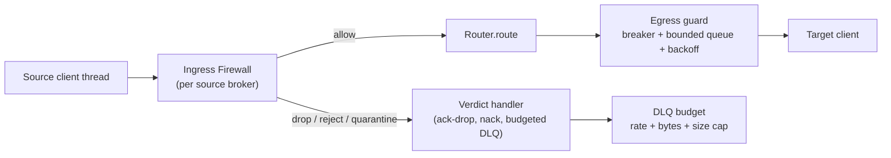

# DoS Protection & Ingress Firewall Plan

> Status: **proposal, nothing implemented yet.** Builds on `IMPLEMENTATION_TASKS.md` (Task numbers there are referenced as T1…T12). Findings come from reading the code; limits of library behaviour are marked *verify*.
> Decision recorded from the user: unroutable messages get a policy option, **default `nack`**; `dlq` is opt-in and **must be rate/size/budget limited**.

## 1. Threat model

PostOffice is a *confused deputy*: it accepts from one broker and amplifies into others. An attacker who can publish to any source topic (a compromised device, a tenant, a leaked credential) can try to:

| # | Attack | Mechanism in current code | Impact |
|---|---|---|---|
| A | Message flood | `Router.route()` runs unthrottled on each client's callback thread | CPU saturation, ingest stalls for all routes on that client |
| B | Oversized payloads | No size cap anywhere (`route`, DLQ, buffer); buffer is bounded by *count* only | Memory exhaustion; huge DLQ messages |
| C | Unroutable flood | Every unmatched message is acked and, if a DLQ is set, republished | DLQ becomes a write-amplification sink; Kafka/Rabbit cost |
| D | Poison redelivery | AMQP `nack(requeue=True)` with no cap (review A4); unroutable+DLQ failure also requeues | Infinite hot loop pinning a thread and the broker |
| E | Parser bombs | JSON deeply nested / huge arrays; Avro length-prefixed fields (*verify* fastavro allocation behaviour); Protobuf | CPU/memory, `RecursionError` |
| F | Topic abuse | Unbounded topic length/depth; high-cardinality topics inflate Prometheus labels (`source_broker`, `dlq_topic`) | Memory growth, metric cardinality explosion |
| G | Fan-out amplification | One message × N routes × per-route DLQ; schema conversion per route | Small input, large work |
| H | Retry storms | Breaker half-open probe, reconnect loops, DLQ publish retries have no jitter | Thundering herd on a recovering broker |
| I | Control-plane abuse | Unauthenticated Redis Pub/Sub; `clear_state`, route/broker spam; dynamic Protobuf compile from Redis | Whole fleet reconfigured or stalled |
| J | Slow-consumer back-pressure loss | Routing is synchronous on the broker's thread; a slow target blocks ingest | Cascading stall across unrelated routes |

Honest limit: MQTT QoS 1/2 is acknowledged by paho on receipt, so PostOffice **cannot push back** on an MQTT source. For MQTT the first line of defence is the broker (`max_packet_size`/`message_size_limit`, per-client quotas, inflight limits, ACLs); PostOffice is the second line (drop/shed + disconnect). For AMQP it can bound unacked work with `prefetch_count`; for Kafka it can `pause()`/`resume()` partitions.

## 2. Design: layered defence



### 2.1 Ingress firewall (application-aware)

New package `src/postoffice/ingress/`. A `Firewall` is an ordered list of `Rule`s evaluated **cheapest first**, short-circuiting on the first non-allow verdict. Evaluation must be O(1)-ish per message and never raise (a rule error → verdict per `on_rule_error`, default `reject`).

```python
class Action(Enum): ALLOW; DROP; REJECT; QUARANTINE; THROTTLE
@dataclass(frozen=True)
class Verdict: action: Action; reason: str; rule: str

class Rule(Protocol):
    name: str
    def check(self, ctx: "MessageContext") -> Verdict: ...   # ctx: broker, topic, payload (bytes, not decoded), qos/props, key
```

Verdict semantics (per source protocol):

| Action | Source ack | Notes |
|---|---|---|
| ALLOW | normal path | |
| DROP | ack (silent) | counted in `firewall_dropped_total{rule}`; for floods where preserving the message is pointless |
| REJECT | `nack(requeue=False)` | AMQP: dead-letters if a broker DLX exists, else discards; Kafka: commit and skip; MQTT: no-op |
| QUARANTINE | ack after budgeted DLQ write | DLQ budget exhausted → degrades to DROP, never to unbounded write |
| THROTTLE | not acked / paused | AMQP delay or Kafka `pause()`; MQTT degrades to DROP |

Built-in rules, in evaluation order:

1. **`MaxPayloadBytes(limit)`**: checked on `len(payload)` before any decode. Global default plus per-topic-pattern overrides.
2. **`TopicShape(max_length, max_depth, allow=[patterns], deny=[patterns])`**: rejects hostile topics before they reach the trie or a metric label. Reuses `TopicTrie` for allow/deny globbing.
3. **`RateLimit(key, rate, burst)`**: token bucket(s) keyed by `broker`, `broker+topic`, or an **extracted identity** such as a topic-template capture (`fleet/{device}/telemetry` → `device`) or a header/field. Memory-bounded key table (LRU + TTL) so the limiter itself cannot be DoSed by key cardinality. Also supports a byte-rate bucket.
4. **`Strikes(window, thresholds)`**: tracks repeat offenders; each firewall violation adds a strike; crossing a threshold applies an **exponentially growing cool-down** (base × 2ⁿ, capped, with jitter) during which that key gets DROP at the cheapest layer. Decays after a quiet period.
5. **`ContentGuard`** (application-aware), opt-in per topic pattern:
   - `format="json"`: max depth, max total keys, max array length, max string length; implemented with a bounded streaming/iterative check *before* `json.loads` (avoid `RecursionError`).
   - `schema="Name"`: validate against the registered Avro/Protobuf/JSON schema (reuse `SchemaConverter`), with a pre-check on declared lengths where the format allows.
   - `required_fields` / `field_ranges` / `enum` for business sanity (`qty ≤ 10000`, `status ∈ {…}`).
   - `topic_schema_binding`: topic pattern → expected schema, so `plant1/+/temperature` can only carry `MachineReading`.
6. **`ConcurrencyLimit(max_inflight)`**: caps un-confirmed deliveries per source (works with the fan-out coordinator's pending count). At the cap: THROTTLE (AMQP/Kafka) or DROP (MQTT).

Configuration surface (library and Control Plane):

```python
po.configure_ingress("mqtt_edge", [
    MaxPayloadBytes(64_000),
    TopicShape(max_length=256, max_depth=8, deny=["$SYS/#"]),
    RateLimit(key="topic:fleet/{device}/+", rate=20, burst=50),
    Strikes(window=60, thresholds=[(5, 30), (20, 600)]),
    ContentGuard(topic="fleet/+/telemetry", format="json", max_depth=6, schema="Telemetry"),
])
```

Rules are serializable (`to_dict`/`from_dict`) so the Control Plane can push them to workers (`add_ingress_rules` event) like routes; hot-reload swaps an immutable rule list atomically.

### 2.2 Unroutable-message policy (user decision)

`PostOffice(on_unroutable="nack" | "dlq" | "drop")`, per source broker override, **default `nack`**.

- `nack` → `nack_fn(requeue=False)`. Not `requeue=True`: requeueing an unroutable message is guaranteed to fail again and creates attack D. If a source has no nack support (MQTT), it is counted and dropped.
- `dlq` → goes through the **DLQ budget** (below); on exhaustion falls back to `nack`/drop, counts `dlq_budget_exceeded_total`.
- `drop` → ack and count (the current behaviour when no DLQ is configured).
- **Behaviour change:** the current default is *ack*. Existing tests that assert it need updating; call it out in the changelog.

### 2.3 DLQ budget (`BudgetedDlq`)

Wraps every DLQ write (unroutable, conversion failure, delivery failure, firewall QUARANTINE):

- `max_message_bytes`: payload is **truncated** (envelope keeps `original_size`, `truncated=true`, and a hash) rather than doubled in size by Base64.
- Token bucket in messages/s **and** bytes/s, global and per source broker, so one noisy source cannot consume another's budget.
- Dedupe window: identical (source, topic, error) within N seconds collapses into a counter on the envelope (`repeat_count`) instead of N writes.
- Hard stop: when the DLQ broker's breaker is open, do not buffer DLQ traffic unboundedly (bounded, then drop with a metric). The existing recursion guard stays.
- Metrics: `dlq_budget_exceeded_total{source_broker}`, `dlq_truncated_total`, `dlq_deduped_total`.
- DLQ publishing moves off the callback thread (bounded queue + worker) so a slow DLQ cannot stall ingest (attack J).

### 2.4 Exponential backoff everywhere retries exist

One shared helper `backoff.py`: `ExponentialBackoff(base, factor, cap, jitter="full")` with injectable clock/sleep/random for deterministic tests. Used by:

| Site | Today | Change |
|---|---|---|
| Adapter reconnect (T3) | none / fixed | shared helper, full jitter, cap 30–60 s |
| `CircuitBreaker` recovery | fixed `recovery_timeout` | grow timeout on each failed half-open probe, reset on success; add probe timeout |
| `nack(requeue=True)` loops | unbounded | retry counter in message headers/side table; after N attempts → DLQ (budgeted) or drop; delay between redeliveries via backoff |
| DLQ/egress publish retry | none | bounded attempts with backoff |
| Data Plane listener/resync (T7) | exp. backoff, no jitter | add jitter, resync storm guard (workers desync) |
| `Strikes` cool-down | n/a | exponential, per offender |

### 2.5 Resource bounds & back-pressure

- **Bounded ingest→egress hand-off** (P3.3 promoted): a per-target bounded queue and worker; when full, apply the configured overflow policy (`reject`/`drop_oldest` already exist for buffers) and propagate back-pressure (AMQP `basic_qos(prefetch_count=N)`, Kafka `pause()`/`resume()`).
- **Buffer limits by bytes and age**, not only count (`max_publish_buffer_bytes`, `max_age`).
- **Fan-out cap**: `max_routes_per_topic` and a per-message work budget; refuse to register a route set that exceeds it.
- **Metric cardinality guard**: label values (`topic`, `dlq_topic`) are bucketed or hashed beyond a configured distinct-value cap (`other`).
- **Message-size limits at the adapters** where the library supports it (Kafka `message.max.bytes`, `fetch.message.max.bytes`; pika frame size; paho has no client-side limit, so enforce in the firewall).
- **Parser safety**: bounded JSON check (above); Avro/Protobuf decode inside a size guard; run with `sys.setrecursionlimit` untouched and catch `RecursionError`/`MemoryError` → REJECT.

### 2.6 Control-plane protection (attack I)

Overlaps T5/T7. Add: Redis password/TLS/ACL (T5), **HMAC-signed events** with a shared key so workers drop forged updates, a rate limit and size cap on incoming events, an allow-list of event actions per worker (e.g. workers may refuse `clear_state` unless `ALLOW_CLEAR_STATE=1`), validate event payloads against a schema before `**kwargs` splatting, and a limit on Protobuf definition size/complexity before dynamic compilation.

### 2.7 Observability

`firewall_verdicts_total{broker,rule,action}`, `firewall_latency_seconds`, `ratelimit_tokens{key_class}`, `strikes_active`, `ingress_inflight`, `dlq_*` above, `backoff_attempts_total{site}`. Alert recommendations go into `docs/user-guide/observability-and-dlq.md`.

## 3. Task breakdown

Same conventions as `IMPLEMENTATION_TASKS.md`: TDD, hermetic, injectable clock, one commit per task, full suite green. Suggested position: after T6 (typed `Route`/pipeline), because the firewall hooks in at one place in the refactored `route()`.

### Task D1: Backoff helper (`src/postoffice/backoff.py`)

**Produces:** `ExponentialBackoff(base: float, factor: float = 2.0, cap: float = 30.0, jitter: str = "full", rng: random.Random | None = None)` with `.next() -> float` and `.reset() -> None`.
- [ ] Failing tests: `test_delays_grow_exponentially_without_jitter`, `test_delay_never_exceeds_cap`, `test_full_jitter_within_zero_and_ceiling` (seeded rng), `test_reset_restarts_sequence`.
- [ ] Implement; full suite; commit `feat: shared exponential backoff helper`.
- Then adopt it (separate commits): T3 reconnect loops, `CircuitBreaker` probe growth + probe timeout (`test_failed_probe_doubles_recovery_timeout`, `test_success_resets_timeout`), Data Plane listener jitter.

### Task D2: Unroutable policy + `BudgetedDlq` — DONE

Implemented: `postoffice/ratelimit.py` (`TokenBucket`), `dlq.BudgetedDlq`, `Router.set_unroutable_policy/set_dlq_budget`, `PostOffice(on_unroutable=...)`. Deferred to D4: identical-error dedupe (`repeat_count`) and the metadata-only record for refused oversize payloads, which need the sender ledger. `TokenBucket` lives in `postoffice/ratelimit.py`, not `ingress/`, so D3 reuses it.

**Files:** `router.py`, `dlq.py` (new `BudgetedDlq`), `app.py` (`on_unroutable`), `metrics.py`; Test `tests/test_unroutable_policy.py`, `tests/test_dlq_budget.py`.
**Produces:** `PostOffice(on_unroutable: str = "nack")`, `set_unroutable_policy(broker, policy)`, `BudgetedDlq(max_message_bytes, msgs_per_sec, bytes_per_sec, dedupe_window, clock)`.
- [ ] Failing tests: `test_default_unroutable_calls_nack_without_requeue`; `test_policy_dlq_publishes_envelope`; `test_policy_drop_acks`; `test_invalid_policy_raises_value_error`; `test_dlq_truncates_oversized_payload_and_records_original_size`; `test_dlq_rate_limit_exceeded_falls_back_to_nack`; `test_per_source_budget_isolated`; `test_identical_errors_deduped_with_repeat_count`; `test_dlq_budget_exceeded_metric_incremented`.
- [ ] Implement; update the existing tests that asserted ack-on-unroutable; commit `feat(router): unroutable policy (default nack) and budgeted DLQ`.

### Task D3: Ingress firewall core + size/shape/rate rules (DONE)

Implemented: `ingress/{rules,firewall}.py`, `ratelimit.KeyedLimiter`, `Router.set_firewall`, `PostOffice.configure_ingress` (Firewall or dict), `postoffice_ingress_total{source_broker,rule,action}`. Verdicts carry a `category` for the D4 ledger. Not yet done: loading rules from a JSON/YAML file in the worker (`from_dict` is the shared path; wiring deferred to D10 with docs).

**Files:** Create `src/postoffice/ingress/{__init__,firewall,rules,ratelimit}.py`; Modify `router.py`, `app.py` (`configure_ingress`); Test `tests/test_firewall_*.py`.
**Produces:** `Action`, `Verdict`, `MessageContext`, `Firewall.evaluate(ctx) -> Verdict`, `TokenBucket(rate, burst, clock)`, `KeyedLimiter(max_keys, ttl, clock)`, rules `MaxPayloadBytes`, `TopicShape`, `RateLimit`.
- [ ] Failing tests: payload over limit → REJECT without decoding; topic too long/deep/denied → REJECT; token bucket allows burst then denies, refills with fake clock; keyed limiter evicts LRU past `max_keys` (limiter memory is bounded); identity extraction from topic template; rule exceptions yield `on_rule_error` verdict; DROP acks, REJECT nacks with `requeue=False`; firewall runs before trie match (assert `client_tries` not consulted on reject); metrics counted.
- [ ] Implement; commit `feat(ingress): firewall core with size, topic-shape and rate-limit rules`.

### Task D4: SenderLedger (observe-first) then opt-in cool-down (DONE)

Implemented: `ingress/ledger.py` (`SenderLedger`: bounded LRU+TTL keys with `other` overflow row, window trend, `likely_cause`, opt-in `enforce` cool-down on D1 `ExponentialBackoff` with quiet-period decay), `Firewall(ledger=)` / `from_dict["ledger"]` (cooled senders DROPped before rules; `rule_error` never blamed on sender), unroutable events recorded by `Router`, `PostOffice.sender_report(top)`, metric `postoffice_sender_events_total{source_broker,category}`. Rising senders log one WARNING per window. Not yet done (moved to D8/D10): DLQ identical-error dedupe (`repeat_count`) and the metadata-only DLQ record for refused oversize; per-top-N sender labels on Prometheus (omitted for cardinality; use `sender_report`); AMQP `user_id`/Kafka key extraction into `MessageContext.sender` (field exists, plugins do not populate it yet).

See 5.1. Tests: counters per category and sender; trend detection with a fake clock; LRU/TTL bounds with an `other` bucket; `sender_report(top=N)` shape; observe-only mode never changes a verdict; with `enforce=True` repeated violations start an exponentially growing cool-down.

- [ ] Failing tests with fake clock: threshold crossing starts a cool-down; repeated crossing doubles it up to the cap; quiet period decays strikes; cooled key is DROPped before other rules run.
- [ ] Implement on top of D1 + D3; commit `feat(ingress): escalating offender cool-down`.

### Task D5: ContentGuard (application-aware)

**Files:** `ingress/content.py`; reuse `schema/converters.py`.
- [ ] Failing tests: JSON nested beyond `max_depth` → REJECT with no `RecursionError`; too many keys / long array / long string; schema mismatch → REJECT; required field missing; field range/enum violation; topic→schema binding enforces per-pattern; invalid UTF-8; guard skipped for topics without a rule (cost is zero).
- [ ] Implement iterative bounded scan; commit `feat(ingress): application-aware content guard`.

### Task D6: Back-pressure and concurrency limit

**Files:** `ingress/concurrency.py`, `plugins/amqp_client.py` (`prefetch_count`), `plugins/kafka_client.py` (`pause`/`resume`), `base_client.py` (`pause_consumption`/`resume_consumption` hooks, default no-op).
- [ ] Failing tests: at `max_inflight` AMQP prefetch is set and further deliveries are not acked until capacity frees; Kafka `pause` called at the cap and `resume` below a low-water mark; MQTT degrades to DROP; counter decrements on confirm and on error (no leak).
- [ ] Commit `feat(ingress): bounded in-flight with protocol-native back-pressure`.

### Task D7: Retry caps for requeue loops

- [ ] Failing tests: `nack(requeue=True)` path stops after N attempts (counter keyed by message id/header) and goes to budgeted DLQ or drop; redelivery delay follows backoff.
- [ ] Commit `fix(amqp): cap poison redelivery`. (Supersedes the A4 sub-item of T2.)

### Task D8: Bounded buffers and cardinality guards

- [ ] Failing tests: buffer rejects when `max_publish_buffer_bytes` exceeded; items older than `max_age` are discarded on flush with `on_error`; metric labels beyond the distinct cap collapse to `other`; `max_routes_per_topic` enforced at `add_route`.
- [ ] Commit `feat: byte/age buffer limits and metric-cardinality guard`.

### Task D9: Control-plane hardening

- [ ] Failing tests: unsigned or wrongly signed event ignored with a metric; `clear_state` ignored unless enabled; oversized event rejected; Protobuf definition over size cap rejected; event rate limit sheds excess; firewall rules sync via Control Plane event and hot-swap atomically.
- [ ] Depends on T5 (Redis auth/TLS) and T7 (convergent sync); commit `feat(plane): signed events and event limits`.

### Task D10: Documentation and load test

- [ ] New `docs/user-guide/ingress-firewall.md` (rule reference, verdict table, MQTT back-pressure caveat, broker-side limits checklist); update `docs/use-cases/fit-and-limits.md`.
- [ ] Opt-in load test under the integration tier (T12): flood at N msg/s, assert bounded memory, bounded DLQ writes, and healthy routes unaffected.

## 4. Order and effort

D1 → D2 → T6 (existing plan) → D3 → D4 → D5 → D6 → D7 → D8 → D9 → D10. D1+D2 are small and deliver the user's immediate decision; D3 is the largest and the foundation for D4–D6.

## 5. Decisions

| # | Question | Decision (2026-10-25) |
|---|---|---|
| 1 | Default unroutable nack | `nack(requeue=False)`, default. Note: for Kafka and MQTT a non-requeue nack is effectively skip, so it must be counted (`unroutable_total`) and visible, not silent |
| 2 | MQTT back-pressure | Pending; explained to the user, see message history |
| 3 | Rule config format | **Both**: Python API and a YAML/JSON file loaded by the worker (same `from_dict` path) |
| 4 | Oversized DLQ payloads | **Refuse to store** (no truncation). Record a metadata-only event instead and attribute it to the sender; see 5.1 |

### 5.1 Sender behaviour ledger (replaces the "Strikes" framing)

Goal: *track* before *punishing*. Oversize, malformed, rate-exceeded and unroutable events may be misconfiguration or a buggy device as often as an attack, so nothing here assumes malice.

- `SenderLedger` records per `(source_broker, sender_key)` counters by **category**: `oversize`, `malformed`, `rate_exceeded`, `unroutable`, `schema_mismatch`, `forbidden_topic`. `sender_key` is the most specific identity available: topic-template capture (device id), AMQP `user_id`/routing key, Kafka message key, else the topic itself.
- Bounded memory (LRU + TTL on keys); the ledger cannot be DoSed by key cardinality. Keys beyond the cap aggregate into `other` and are counted.
- Per sender it keeps: first/last seen, counts per category per window, and a short rolling rate, so a **rising trend** is visible (current window vs. previous window), not only totals.
- Exposed three ways: Prometheus (`sender_events_total{broker,category}` with sender label only for the top-N offenders, to protect cardinality), a `po.sender_report(top=N)` call returning structured rows, and a periodic WARNING log naming senders whose rate has risen past a configured factor.
- Each row carries a `likely_cause` hint to steer diagnosis, not to accuse: repeated identical error from one sender suggests misconfig or a stuck device; broad varied errors across many senders suggest an outage or bad rollout; high rate of mixed categories from one sender suggests abuse.
- **Enforcement is separate and opt-in**: cool-down/escalation (the old `Strikes`) only acts when a policy is set (`enforce=True`). The default is observe-only.
- Oversized payloads: DLQ stores a **metadata-only** record (source, topic, sender, original size, rule) when the budget allows, or just the ledger entry; never the body.

1. **Nack semantics:** the plan uses `requeue=False` for the default unroutable nack (requeue would loop forever). On AMQP that discards the message unless a broker-side DLX exists. Confirm this is wanted, or choose `requeue=True` with a retry cap (D7).
2. **MQTT sources:** accept that PostOffice can only shed (drop/disconnect), not slow, MQTT publishers, with broker-side limits as the real control?
3. **Rule configuration format:** Python API only first, or also YAML/JSON file loaded by the worker?
4. **Truncation vs. rejection** for oversized messages entering the DLQ: truncate-with-hash (planned) or never store?
