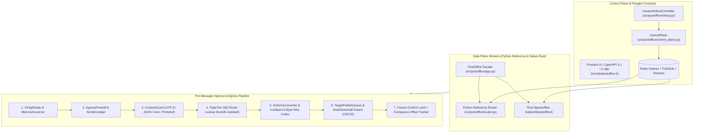

# PostOffice Architecture & Semantic Mapping

PostOffice acts as a high-throughput, hybrid Rust/Python multi-protocol messaging router and semantic translation bridge between MQTT, NanoMQ, AMQP (RabbitMQ), and Apache Kafka.

---

## 1. Hybrid Architecture Overview

PostOffice is organized into two synchronized planes and a dual-engine execution model ([ADR-0001](adr/0001-native-data-plane-language.md), [ADR-0002](adr/0002-phase5-consolidation.md)):

### Component Roles
1. **Native Rust Data Plane Core (`native/libpostoffice/`):**
   - Zero-dependency Rust shared/static library (`libpostoffice.so` / `libpostoffice.a`) exported via a stable C ABI (`include/postoffice.h`) and bound in Python via `src/postoffice/native.py`.
   - Implements the hot path: `TopicTrie`, `IngressFirewall`, `ContentGuard`, `SenderLedger`, `MemoryGovernor`, `BudgetedDlq`, `SchemaConverter`, `TargetPublishQueue`, `DiskStoreAndForward`, protocol confirmation/offset state machines (`KafkaOffsetTracker`, `AmqpConfirmTracker`, `MqttPubackTracker`), and `NativeEngine` with Redis RESP2 `T7` + `XRANGE` synchronization.
2. **Python Control Plane, Facade & Reference Oracle (`src/postoffice/`):**
   - `PostOffice` (`src/postoffice/app.py`): Uniform programmatic facade supporting both the Python reference router and in-process `NativeEngine` (`use_native_engine=True` / `route_native()`).
   - `ControlPlane` (`src/postoffice/control_plane.py`): Manages cluster state in Redis hashes, signs events with HMAC-SHA256 (`src/postoffice/signing.py`), broadcasts on `postoffice:config_updates`, and appends durable entries to Redis Stream `postoffice:config_stream`.
   - **Executable Specification & Oracle:** Verified against the native Rust engine on every commit via `conformance/run.py --both` (`71/71` language-neutral conformance vectors) and `ShadowModeRunner` (`src/postoffice/shadow.py`).

---

## 2. Protocol Semantics & Translation Mapping

Different messaging protocols have distinct delivery guarantees, routing rules, and durability models:

| Protocol | Design | QoS / Delivery Guarantees | Routing Model |
|---|---|---|---|
| **MQTT / NanoMQ** | Lightweight edge pub/sub | QoS 0 (at-most-once), QoS 1 (at-least-once via `PUBACK`), QoS 2 (exactly-once) | Hierarchical `/`-delimited topics with `+` and `#` wildcards; `$`-prefixed system topics isolated |
| **AMQP (RabbitMQ)** | Enterprise queueing & exchanges | Consumer `basic.ack` / `basic.nack`, publisher confirms (`confirm.select`), `mandatory=True` unroutable return | Exchanges (Direct, Topic, Fanout) and Queue bindings |
| **Apache Kafka** | Distributed partitioned commit log | Producer delivery reports (`acks=all`), consumer group offsets committed only up to contiguous completed watermark | Topics and Partition keys |

### End-to-End Translation Rules
- **MQTT -> AMQP:**
  - MQTT QoS 0 maps to transient AMQP (`delivery_mode=1`).
  - MQTT QoS 1/2 maps to persistent AMQP (`delivery_mode=2`) with publisher confirms; upstream MQTT `PUBACK` fires only after AMQP broker confirmation.
- **MQTT -> Kafka:**
  - MQTT QoS 1/2 waits for the Kafka producer delivery report callback before acknowledging the upstream MQTT packet.
- **AMQP -> MQTT:**
  - Persistent AMQP (`delivery_mode=2`) publishes at MQTT QoS 1 and issues `basic.ack` only after receiving the downstream MQTT `PUBACK`.
- **Kafka -> MQTT / AMQP:**
  - `KafkaOffsetTracker` tracks per-partition in-flight offsets and commits `highest_contiguous_completed + 1`, preventing out-of-order fan-out completions from advancing the committed offset past an unconfirmed message.

---

## 3. Ingress Firewall, Backpressure & Durability

1. **Pre-Routing DoS Defense (`src/postoffice/ingress/`, `native/libpostoffice/src/lib.rs`):**
   - `InFlightGate` bounds concurrent in-flight messages globally and per source broker.
   - `MemoryGovernor` enforces byte-accounted budgets (cgroup-aware, shedding load at 80% watermark).
   - `IngressFirewall` evaluates `MaxPayloadBytes`, `TopicShapeRule` (length, depth, wildcard count, forbidden prefixes), `RateLimitRule` (token bucket), and `ContentGuard` (streaming UTF-8/JSON depth/key-count validator and Avro/Protobuf schema check).
   - `SenderLedger` tracks per-sender violations with opt-in escalating cool-downs.
2. **Egress Resiliency & Edge Store-and-Forward (`native/libpostoffice/src/queue.rs`, `src/postoffice/base_client.py`):**
   - Per-target `CircuitBreaker` (`CLOSED`, `OPEN`, `HALF_OPEN`) isolates degraded target brokers.
   - `TargetPublishQueue` enforces bounded FIFO buffering (`max_messages`, `max_bytes`, `max_age_sec`) with `"reject"` or `"drop_oldest"` overflow policies.
   - Opt-in `DiskStoreAndForward` (`disk_store_path`) persists queued egress messages to an append-only log with `size_cap_bytes`, wear-aware batching (`batch_max_messages`, `batch_max_bytes`, `flush_interval_sec`), and IEEE CRC32 record framing (`0x4653_4f50` `"POSF"`) with automatic crash truncation of torn tail frames.
3. **Budgeted Dead Letter Queue (`src/postoffice/dlq.py`):**
   - Token-bucket rate-limited DLQ with identical-error deduplication, payload-free oversize records, and `requeue=False` anti-recursion protection.

---

## 4. Distributed Control Plane & Mixed-Fleet Rollout

1. **Subscribe-Before-Snapshot Convergence (`T7` + Redis Streams):**
   - Data Plane workers subscribe to `postoffice:config_updates` *before* reading the Redis hash snapshot (`postoffice:config_version`, `postoffice:brokers`, `postoffice:routes`, `postoffice:subscriptions`, `postoffice:ingress`), buffering live events and replaying missed versions via Redis Stream `postoffice:config_stream` (`XRANGE`).
2. **Signed Control Events:**
   - Control Plane mutations are signed with keyed HMAC-SHA256 (`HmacSigner`) and validated by Data Plane workers (`signing_mode="off" | "observe" | "enforce"`).
3. **Canary Rollout (`src/postoffice/rollout.py`):**
   - Routes carry an `engine` tag (`"any"`, `"python"`, `"native"`). `CanaryRolloutController` ramps route assignments across `5% -> 25% -> 100%` and automatically rolls back to `"python"` if error rate, DLQ rate, p99 latency, or consumer lag breaches configured SLO thresholds.
