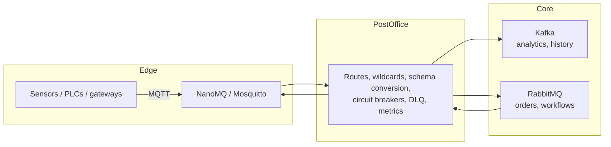

# PostOffice Use Cases

[← Project README](../../README.md) | [User Guide](../user-guide/README.md)

PostOffice is a **protocol bridge and message router**. It sits between systems that speak different messaging protocols (MQTT, AMQP/RabbitMQ, Kafka, NanoMQ) and lets you connect them with configuration instead of glue code.

## Table of Contents
- [The problem it solves](#the-problem-it-solves)
- [What you get](#what-you-get)
- [Is PostOffice a fit?](#is-postoffice-a-fit)
- [Use-case guides](#use-case-guides)
- [Reusable patterns](#reusable-patterns)
- [Where to go next](#where-to-go-next)

---

## The problem it solves

Real organisations rarely run one messaging system. Shop-floor devices and gateways speak **MQTT**. Enterprise and transactional systems sit on **RabbitMQ (AMQP)**. Analytics and event history live in **Kafka**. Each team picks what suits its job, and then someone has to move data between them.

The usual answer is a pile of one-off bridge scripts: each with its own reconnect logic, its own error handling, its own idea of what a topic name means, and no shared visibility. When one breaks, messages vanish and nobody knows.

PostOffice replaces that pile with one routing layer:

## What you get

| Capability | What it means for you | Detail |
|---|---|---|
| **Cross-protocol routing** | Any supported broker can be a source or a target | [Routing & wildcards](../user-guide/routing-and-wildcards.md) |
| **Wildcard topics** | One rule covers thousands of devices (`plant/+/line/+/temp`, `site/#`) | [Routing & wildcards](../user-guide/routing-and-wildcards.md) |
| **Schema conversion** | JSON ⇄ Avro ⇄ Protobuf, including Confluent wire framing | [Schema transformation](../user-guide/schema-transformation.md) |
| **Delivery semantics mapping** | MQTT QoS ⇄ AMQP delivery mode, acknowledgements tied to delivery | [Delivery guarantees](../user-guide/delivery-guarantees.md) |
| **Dead-letter queue** | Messages that cannot be delivered are kept, with the reason, not dropped | [Observability & DLQ](../user-guide/observability-and-dlq.md) |
| **Circuit breakers and buffering** | A downstream outage does not take the whole bridge down | [Resiliency](../user-guide/resiliency-and-circuit-breakers.md) |
| **Prometheus metrics** | See throughput, errors and DLQ volume per broker | [Observability & DLQ](../user-guide/observability-and-dlq.md) |
| **Live reconfiguration** | Change routes and rotate credentials on running workers via Redis | [Distributed plane](../user-guide/distributed-plane.md) |
| **Embeddable or standalone** | Use as a Python library, or run horizontally scaled workers | [Distributed plane](../user-guide/distributed-plane.md) |

## Is PostOffice a fit?

Good fit when:
- You have **two or more messaging systems** that need to exchange data.
- You want routing to be **declared, not coded**, and changeable without redeploying.
- Your payloads are small to medium **events and telemetry** rather than large files.
- You want **one place** to see failures (DLQ) and rates (metrics).

Probably not a fit when:
- You only use one broker. Use that broker's native features.
- You need **exactly-once** or distributed transactions across systems. PostOffice aims for at-least-once; see [Fit, limits and design decisions](fit-and-limits.md).
- You need heavy stream processing (joins, windows, aggregations). Use Kafka Streams, Flink or similar *after* PostOffice delivers the data.

## Use-case guides

| Guide | For readers who… |
|---|---|
| [Industrial IoT and manufacturing](industrial-iot-and-manufacturing.md) | run plants, lines, PLCs, historians, MES/ERP integration |
| [IoT and edge computing](iot-and-edge.md) | run fleets of devices, gateways, remote sites with unreliable links |
| [Data systems and processing](data-systems-and-processing.md) | build data platforms, pipelines, lakehouses, ML feature feeds |
| [Business transactions](business-transactions.md) | move orders, payments, inventory and notifications between systems |
| [Business management](business-management.md) | want operational visibility, KPIs, alerting and integration across departments |
| [Other industries](other-industries.md) | work in energy, logistics, healthcare, retail, smart buildings, finance, agriculture |
| [Fit, limits and design decisions](fit-and-limits.md) | are deciding whether to adopt it and what to verify first |

## Reusable patterns

Every guide combines the same handful of patterns. Learn these once.

| Pattern | Shape | Typical use |
|---|---|---|
| **Fan-in** | many MQTT topics → one Kafka topic | collect telemetry from devices into a data platform |
| **Fan-out** | one source → several targets | feed analytics, alerting and archive at once |
| **Command return path** | AMQP/Kafka → MQTT | send commands or setpoints back to devices |
| **Format gateway** | JSON in → Avro/Protobuf out | compact, schema-governed downstream data |
| **Quarantine** | failures → DLQ topic | keep bad or undeliverable messages for review and replay |
| **Shield** | circuit breaker + buffer | survive downstream outages without losing the stream |
| **Control-plane rollout** | admin script → Redis → N workers | change routing across a fleet live |

## Where to go next

- Try the [Quickstart](../../README.md#quickstart).
- Read the guide for your domain above.
- Check [Fit, limits and design decisions](fit-and-limits.md) before a production rollout.
