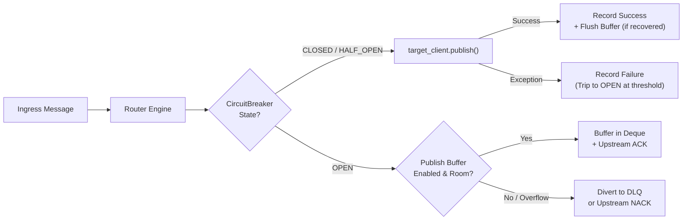

# Operational Resiliency, Client Queuing & Circuit Breakers

[← Back to User Guide](README.md) | [← Back to Project README](../../README.md)

PostOffice provides three layers of operational resiliency (`RES-01`, `RES-02`, `RES-03`) to prevent message loss during broker restarts, downstream outages, and certificate or credential rotations.

---

## Table of Contents
- [Overview](#overview)
- [Client Subscription & Publish Queuing (`RES-01`)](#client-subscription--publish-queuing-res-01)
  - [Offline Subscription Replay with Broker Options](#offline-subscription-replay-with-broker-options)
  - [Bounded In-Flight Publish Buffer & Overflow Policies](#bounded-in-flight-publish-buffer--overflow-policies)
- [Egress Circuit Breakers & Ring-Buffer Failover (`RES-02`)](#egress-circuit-breakers--ring-buffer-failover-res-02)
  - [Circuit Breaker State Machine](#circuit-breaker-state-machine)
  - [Configuring Circuit Breakers](#configuring-circuit-breakers)
  - [Ring-Buffer Failover Before DLQ Drop](#ring-buffer-failover-before-dlq-drop)
- [Live Credential & Certificate Hot-Reload (`RES-03`)](#live-credential--certificate-hot-reload-res-03)
- [Reference](#reference)

---

## Overview



---

## Client Subscription & Publish Queuing (`RES-01`)

All four transport plugins (`MqttClient`, `NanoMqClient`, `AmqpClient`, and `KafkaClient`) inherit a thread-safe subscription registry and bounded publish buffer from `BaseClient`.

### Offline Subscription Replay with Broker Options

Subscriptions registered via `po.subscribe()` before `po.start()`—or while a broker is disconnected—are stored along with their protocol-specific keyword arguments (`qos`, `exchange`, `exchange_type`, `queue`, `auto_ack`) and replayed automatically upon connection or reconnection:

```python
from postoffice.app import PostOffice

po = PostOffice()
po.add_broker("mqtt_edge", "mqtt", host="localhost", port=1883)
po.add_broker("rabbit_core", "amqp", host="localhost", port=5672)

# Registered before po.start() — options are preserved and replayed on connect/reconnect
po.subscribe("mqtt_edge", "sensors/+/telemetry", qos=2)
po.subscribe(
    "rabbit_core",
    "orders.#",
    exchange="commerce",
    exchange_type="topic",
    queue="orders_worker_q",
    auto_ack=False,
)
```

### Bounded In-Flight Publish Buffer & Overflow Policies

When `enable_publish_buffer=True` is set on a broker, messages published while the client is disconnected (or while its egress circuit breaker is `OPEN`) are queued in a bounded `collections.deque` and flushed in FIFO order as soon as connectivity returns.

```python
from postoffice.app import PostOffice
from postoffice.base_client import BufferOverflowError

po = PostOffice()

# 1. "drop_oldest" policy: evicts the oldest buffered message when full
po.add_broker(
    "mqtt_ring",
    "mqtt",
    host="localhost",
    port=1883,
    enable_publish_buffer=True,
    max_publish_buffer_size=500,
    buffer_overflow_policy="drop_oldest",
)

# 2. "reject" policy (default): raises BufferOverflowError when full
po.add_broker(
    "kafka_strict",
    "kafka",
    bootstrap_servers="localhost:9092",
    enable_publish_buffer=True,
    max_publish_buffer_size=1000,
    buffer_overflow_policy="reject",
)
```

---

## Egress Circuit Breakers & Ring-Buffer Failover (`RES-02`)

### Circuit Breaker State Machine

Each target broker registered in `Router` can be protected by an independent `CircuitBreaker` (`src/postoffice/resiliency.py`):

1. **`CLOSED` (`0`):** Normal operation. Egress publishes pass through to the target broker. Consecutive publish failures increment `failure_count`.
2. **`OPEN` (`1`):** Tripped when `failure_count >= failure_threshold`. Live network calls to the failing broker are short-circuited for `recovery_timeout` seconds.
3. **`HALF_OPEN` (`2`):** Once `recovery_timeout` elapses, the next routed message acts as a single recovery probe:
   - If the probe succeeds, the breaker transitions to `CLOSED`, resets `failure_count`, and flushes any messages queued in the target broker's publish buffer (`flush_publish_buffer()`).
   - If the probe fails, the breaker immediately re-opens (`OPEN`) and resets the recovery timer.

### Configuring Circuit Breakers

Configure circuit breakers either inline during `add_broker()` or explicitly via `configure_circuit_breaker()`:

```python
from postoffice.app import PostOffice

po = PostOffice(metrics_port=9100, dlq_broker="dlq_bus", dlq_topic="system.dlq")

# Inline configuration on add_broker
po.add_broker(
    "kafka_analytics",
    "kafka",
    bootstrap_servers="localhost:9092",
    enable_publish_buffer=True,
    max_publish_buffer_size=2000,
    buffer_overflow_policy="drop_oldest",
    circuit_breaker_threshold=5,
    circuit_breaker_timeout=30.0,
)

# Or configure/update dynamically at runtime
po.configure_circuit_breaker(
    "kafka_analytics",
    failure_threshold=3,
    recovery_timeout=15.0,
)
```

### Ring-Buffer Failover Before DLQ Drop

When a route targets a broker whose `CircuitBreaker` is `OPEN`:
- **If `enable_publish_buffer=True` on the target client:** `Router` enqueues the transformed payload into the target broker's in-flight publish buffer and acknowledges the upstream source (`coordinator.on_confirm()`). When the circuit breaker later recovers (`HALF_OPEN -> CLOSED`), `Router` automatically flushes the buffered messages to the target broker.
- **If `enable_publish_buffer=False` or the buffer is full (`BufferOverflowError`):** `Router` raises `CircuitBreakerOpenError`, increments `postoffice_routing_errors_total{error_type="circuit_breaker_open"}`, and diverts the message to the configured Dead Letter Queue (or triggers `nack_fn(requeue=True)` if no DLQ is configured).

---

## Live Credential & Certificate Hot-Reload (`RES-03`)

Rotate expired TLS certificates, mTLS client keys, or SASL passwords at runtime without dropping subscriptions or losing buffered messages:

```python
from postoffice.security import SecurityConfig

rotated_sec = SecurityConfig(
    tls_enabled=True,
    ca_cert="/etc/ssl/certs/ca-2027.pem",
    client_cert="/etc/ssl/certs/client-2027.pem",
    client_key="/etc/ssl/private/client-2027.key",
    username="rotated_service_user",
    password="rotated_secret_password",
    sasl_mechanism="SCRAM-SHA-512",
)

# Standalone facade hot-reload
po.reload_broker_security("kafka_analytics", rotated_sec)
```

For multi-worker clusters, broadcast the rotation via `ControlPlane.update_broker_security()`:

```python
from postoffice.control_plane import ControlPlane

cp = ControlPlane(redis_host="localhost", redis_port=6379)
cp.update_broker_security("kafka_analytics", rotated_sec)
```

---

## Reference

### Client Queuing Parameters (`BaseClient` / `add_broker`)

| Parameter | Type | Default | Description |
|---|---|---|---|
| `enable_publish_buffer` | `bool` | `False` | Buffers outgoing messages while disconnected or when circuit breaker is `OPEN`. |
| `max_publish_buffer_size` | `int` | `1000` | Maximum number of in-flight messages retained in the client deque (`>= 1`). |
| `buffer_overflow_policy` | `str` | `"reject"` | Overflow behavior when buffer is full: `"reject"` (raises `BufferOverflowError`) or `"drop_oldest"`. |
| `circuit_breaker_threshold` | `Optional[int]` | `None` | Consecutive egress failures before tripping circuit breaker to `OPEN` (`>= 1`). |
| `circuit_breaker_timeout` | `float` | `30.0` | Seconds before an `OPEN` circuit breaker transitions to `HALF_OPEN` (`>= 0`). |

### Resiliency Classes & Exceptions

| Symbol | Module | Description |
|---|---|---|
| `BufferedPublish` | `postoffice.base_client` | Frozen dataclass (`topic`, `payload`, `kwargs`) representing a queued outbound message. |
| `BufferOverflowError` | `postoffice.base_client` | Raised when `_publish_buffer` is full and `buffer_overflow_policy="reject"`. |
| `CircuitBreaker` | `postoffice.resiliency` | Thread-safe state machine (`CLOSED`, `OPEN`, `HALF_OPEN`) guarding egress broker calls. |
| `CircuitState` | `postoffice.resiliency` | `IntEnum` (`CLOSED = 0`, `OPEN = 1`, `HALF_OPEN = 2`) exported to Prometheus gauges. |
| `CircuitBreakerOpenError` | `postoffice.resiliency` | Raised when a call is rejected by an `OPEN` circuit breaker and cannot be buffered. |
